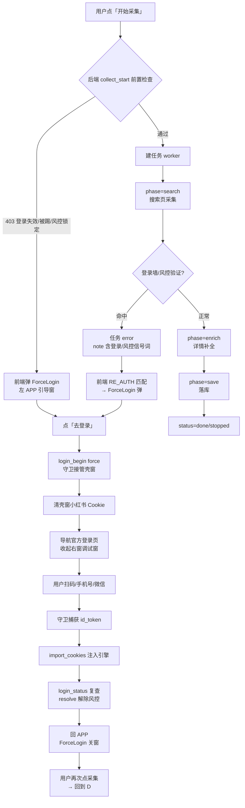

# 采集与登录闭环 操作流程 SOP

> 版本：v1.1（2026-11-06）
> v1.1 变更（对齐 R-6.53z 系列代码现状，逐条取证后改写，不加推测）：
> - S1 停止语义改为「stop_event + task.cancel()」（R-6.53v），补 `_reset_collection_data` 清库时序（R-6.25）
> - S2 由「search→enrich→save 三阶段批处理」改为**逐条流水线**（R-6.53z：一条一补全/评分/入库/commit）
> - S3 补两条 saved=0 收尾分支（候选全被拒收 / 搜索页空壳）
> - B1 由「待修复」改为「已修复（`e2ec0cc`），2026-11-06 核实 `mark_hard` 已无调用方」；新增 B6-B8
> - 新增 §八「R-6.53z 系列变更与质量门禁」、§六 TS8-TS10
> - v1.1 补记（同日）：CC 基线 14→0 清零，`backend/src` 全函数 CC≤8；新增登录守卫单测 15 例（`test_shell_guard_unit.py`），§8.4/§8.5 已按实测改写
> 与「多专家角色迭代开发工作流.md」的关系：本文是**领域操作 SOP**（采集/登录的具体操作流程与判定口径）；工作流 SOP 是**迭代过程元 SOP**（如何多角色协作开发）。两者互补——工作流 SOP §七.4 已引用本文作为验收口径，本文反向引用工作流 SOP 作为迭代流程依据。
> 用途：把「点开始采集 → 采集执行 → 遇到登录/风控 → 引导登录 → 恢复 → 重新采集」的完整操作流程细化到每一步，作为测试、改码、验收的统一口径。
> 约定：本文是「需求文档 × 代码现状」的对齐产物；凡代码行为与用户拍板冲突处，在「五、已知差距」中列明并推进修复。
>
> 补充（R-6.26~6.29 启动时序）：未登录启动后稳定两窗——壳窗（左半，960×800）=`http://127.0.0.1:8791/` 前端 + ForceLogin 引导；Tab2 采集窗（右半）= 本地提示页 `/login-hint`。登录成功（id_token 注入引擎）后 Tab2 自动从 /login-hint 切到 `xiaohongshu.com/explore`；R-6.29 已移除启动期 explore 判定页开窗副作用，无窗口震荡。关主窗=整体退出（R-6.22p），关采集窗=仅关闭。

---

## 一、总览：一次采集的完整生命周期

## 二、用户操作流程（逐步细化）

### S1 点「开始采集」

| 层 | 动作 | 分支/结果 |
|---|---|---|
| 前端 | CollectPanel 提交 collect_start（keyword/limit/筛选/间隔） | — |
| 后端 | `_check_license_or_raise` | 授权闸，free 恒放行 |
| 后端 | `_require_login(account_id)` | **403**：登录失效/被踢/风控锁定 → 前端弹 ForceLogin（见 T1） |
| 后端 | `_check_collect_throttle` | **恒放行**（R-6.15 拍板：拟人频率保护/熔断/锁定全移除） |
| 后端 | 任务唯一键防重启动（dedup 60s） | **已移除**（R-6.22h 拍板：同词/换词均允许立即重启） |
| 后端 | 停止所有 running 旧任务 | `_stop_running_collect_tasks`：置 `stop_event=True` **并** `task.cancel()`（R-6.53v 框架级取消，所有 await 点立即中断，与 `collect_stop` 一致） |
| 后端 | `_reset_collection_data()` | **R-6.25**：新采集清空旧库（笔记+客户+采集图片），保证库里只有本次数据；时序在登录校验**通过之后**，登录失败不破坏数据 |
| 引擎 | `new_page()` 门禁 | 未登录/风控 → 不建独立采集调试窗（引擎窗最小化，任务页走引擎内新页）；登录有效 → 恢复右半屏调试窗 |
| 前端 | 任务状态条播报 phase | search →（逐条流水，无独立 enrich/save 批次）→ done。`collected` 字段实时等于已入库条数 |

### S2 采集执行（R-6.53z 逐条流水线，取代原 search→enrich→save 三阶段批处理）

**核心口径**：采集一条 → 补全一条 → 评分一条 → 入库并 commit 一条 → 播报一条。旧批次模型（先全部提取、再批量补全、最后统一落库）已废弃——它会让界面停在「补全」阶段、停止后结果与显示矛盾。采满 `limit` 自动完成；停止时结果 = 已入库条数（所见即所得）。

| 阶段 | 代码 | 行为 | 异常分支 |
|---|---|---|---|
| search | `_prepare_search_page` | 打开 `search_result?keyword=…`，20s 等 `section.note-item`；空壳时页内 `reload` 最多 2 次（R-6.53u，比关页重开成本低且保留会话） | 登录墙命中 → `_handle_login_wall`（统一软风控 `mark_manual`）+ 抛 `BrowserLoginRequiredError`，页面保留供扫码 |
| search | `search()` 滚动循环 | 逐批 `_drain_page` 提取、去重；`on_progress` 带回 items 引用（取消时抢救已采数据） | 用户停止 → `stop_event` / `task.cancel()` |
| 无候选 | `_collect_finalize_empty` | 直接收尾，落 S3 的两条 saved=0 分支之一 | — |
| 逐条 | `_collect_one` | 单条：`_enrich_fast`（fast 模式）或 `get_feed_detail` + `get_user_profile` → `_rank_and_insert` 评分入库 → **逐条 `con.commit()`** → `saved += 1`、note=「已采集 N 条」 | 单条补全异常**不阻断**：用搜索页粗数据照常评分入库 |
| 收尾 | `_collect_finalize` | 停止 / 采满 / 不足 / 候选全被拒收 四分支（见 S3） | — |
| 取消 | `asyncio.CancelledError` | `_finalize_stopped` 立即收尾已入库数据（逐条 commit 保证不丢），再 re-raise | — |
| 异常 | `except Exception` | status=error + phase=done（任务不悬挂在 running） | 前端 RE_AUTH 匹配 → ForceLogin |
| finally | 资源清理 | `con.close()`（`_db()` 每次新建连接，原闭包版漏关）+ `_mark_collect_done(account_id)` | — |

**注意 `phase` 语义**：search → enrich → save → done 只驱动状态条文案；真实计数唯一权威是 `saved`（= 已入库条数 = 列表卡片数 = DB 行数）。

**登录墙判定词表**（`_detect_login_wall`）：`扫码登录 / 登录后查看 / 请先登录 / 完成验证 / 安全验证 / 验证码`；页面 URL 含 `/login` 直接判失效。

### S3 结果呈现（口径 = `_collect_finalize` 四分支 + `_collect_finalize_empty` 两分支）

| 状态 | note 文案 | 代码分支 | 前端 |
|---|---|---|---|
| done | 采集完成：N 条已按评分排序 | `saved >= limit` | 结果卡片按评分排序 |
| done | 采集完成：平台仅加载 N 条（不足 L），已按评分排序 | `0 < saved < limit` | 同上 |
| done | 未采集到有效数据（候选均缺少笔记 ID），请稍后重试 | 候选非空但**全被 `_rank_and_insert` 拒收**（R-6.53x：无 `feed_id` 脏行不入库） | 同上（0 条，明确提示重试） |
| done | 未采集到数据（小红书限流或页面未加载出内容），请稍后重试 | `_collect_finalize_empty`，搜索阶段 0 候选且非用户停止（R-6.53u：0 条=功能未完成，用户口径） | 同上 |
| stopped | 已停止：采集到 N 条 / 已停止（未采到结果） | `stop_event` 或 res.stopped | 停止态 |
| error | 采集失败：{异常} | `except Exception` | 若 note 命中 RE_AUTH → 弹 ForceLogin |

> 两行 done 变体的意义：saved=0 时**不能报「成功」也不能停在 running**——前者让用户以为功能完成、后者会让 running 判据泄漏连锁污染壳层（见 §五 B7 与 R-6.53z 记录）。

## 三、登录触发链（4 个触发点 → 统一闭环）

### T1 启动 403（登录失效/被踢/风控锁定）
`_require_login` 403 → 前端 `isLoginAbnormal(note)`（RE_AUTH 词表）→ ForceLogin 弹。

### T2 采集遇登录墙（任务 error）
worker error note 含「登录后查看/扫码登录/请先登录/验证」→ 前端 RE_AUTH 匹配 → ForceLogin 弹。

### T3 运行中被踢（引擎页面登录态失效）
被踢信号词（登录超限/请重新登录/登录已过期）→ `login_status` kicked=true → ForceLogin 复查感知。

### T4 用户主动重登（设置页）
`login_begin(force=false)` → 可关闭登录页（不锁死、不拉回）。

### 统一登录闭环（T1-T3 走 force=true）

| 步骤 | 动作 | 说明 |
|---|---|---|
| 1 | ForceLogin 弹出（左 APP 覆盖层） | 打开即调 `collapse_debug_windows` 收起右窗 |
| 2 | 点「去登录」→ `goLogin` → `apiLoginBegin(true)` | `wentLogin=true` |
| 3 | 后端 `login_begin` 置 pending+force，收起调试窗 | 右窗关闭（用户约定：登录引导时右侧要么关闭要么有提示） |
| 4 | 守卫 `login_guard` 轮询到 pending | 先 `clear_domain_cookies("xiaohongshu.com")` 清壳窗 Cookie（否则登录页检测到有效会话自动跳过扫码界面） |
| 5 | 壳窗导航官方登录页 + JS 双保险 | `xiaohongshu.com/login?redirectPath=…`；隐藏关闭按钮（强制登录不可关） |
| 6 | 用户扫码/手机号/微信 | 登录页完整渲染扫码界面 |
| 7 | 守卫页内监视捕获 `id_token` Cookie | 每轮轮询 cookies |
| 8 | `POST /api/auth/import_cookies` | 过滤 xiaohongshu/xhscdn 域 → 注入引擎 → 刷新引擎页 |
| 9 | 回 APP | 守卫导航壳窗回 `127.0.0.1:8791` |
| 10 | ForceLogin 关窗 | 条件：`wentLogin && logged_in && !risk_verify`（每秒复查，异常信号不缓存） |
| 11 | `login_status` 自动 `risk.resolve` | 登录有效 → 解除该账号软风控（manual） |
| 12 | 用户再次点采集 | 走 S1 → 正常执行 |

## 四、状态与判定（权威口径）

- **登录判定四元组**：`(has_ws, page_logged_in, kicked, risk_verify)`
  - has_ws：引擎 Cookie 含 web_session
  - page_logged_in：引擎小红书页实际登录态
  - kicked 词表：登录超限 / 请重新登录 / 登录已过期
  - risk_verify 词表：登录后查看 / 风控拦截 / 需人工扫码 / 人工验证 / 验证后重试
- **缓存规则**：`_LOGIN_CACHE` TTL 15s，**仅正常状态写入**；kicked/risk_verify 异常信号实时返回（R-6.22f）
- **前端 RE_AUTH 词表**：重新登录 / 请登录 / 登录失效 / 登录态 / 被踢 / 登录超限 / 登录已过期 / 需要验证 / 验证登录 / 需人工扫码 / 扫码验证 / 验证后重试

## 五、已知差距（代码现状 vs 拍板约束）

> v1.1 起本表兼作**核实台账**：已修复项保留行并标注核实日期与取证方式，避免「老问题重现」时无据可查。

| # | 差距 | 拍板/约定 | 现状（2026-11-06 核实） | 处置 |
|---|---|---|---|---|
| B1 | 24h 硬熔断残留 | R-6.15「风控熔断不需要」 | **已修复并清理**（`e2ec0cc` + R-6.53z3）：`_handle_login_wall` 只调 `risk.mark_manual`；`mark_hard`/`mark_risk`/`mark_soft`/`mark_throttle`/`check_throttle`/`BlockedError` 全仓无生产调用方，已按「死代码不留」删除，`risk.py` 收敛为 ok/manual 两态 | 保持软风控：登录墙 → manual，登录成功自动 resolve |
| B2 | 登录恢复后任务不自动继续 | 「不限制」拍板未含自动重试 | 任务 error 后需手动再点采集 | 保持手动（ForceLogin/状态条明确提示「登录成功后请重新点击开始采集」） |
| B3 | manual 403 文案体验 | 扫码前再点采集被拦 | 403「页面已打开登录入口，请扫码或完成验证，恢复后自动解除」 | 文案优化 + 明确引导 |
| B4 | 壳窗被登录页接管时 APP 界面消失 | 登录页在壳窗内呈现（用户拍板） | 导航即接管，无过渡提示 | 保留设计；ForceLogin 文案说明「正在打开登录页…」 |
| B5 | 任务 error 后右窗登录墙页短暂保留 | 登录引导才收起右窗 | 已在 ForceLogin 弹出时收起（R-6.22g） | 确认无遗漏路径 |
| B6 | 文档语义滞后（本次已修） | 需求文档必须与代码同源 | S2 曾长期写「三阶段批处理」、S1 曾写「stop_event」，与 R-6.53z/R-6.53v 实际实现不符 | **本次 v1.1 已改写**；后续凡流水线/停止语义再变，必须同 commit 更新 §二 |
| B7 | `browser_client.py` 登录墙注释曾描述「24h 硬熔断残留」 | 注释不得与现状矛盾（误导后续排查） | **已修（2026-11-06）**：`_handle_login_wall` docstring 改为「历史背景（已修复 `e2ec0cc`）」，行内注释改为「统一软风控 → 引导扫码恢复」 | — |
| B8 | `_stop_running_collect_tasks` 与 `collect_stop` 收尾不一致 | 停止要「完全停止」（用户原话） | 两者都 `task.cancel()`；`collect_stop` 另调 `_recover_collect_window` 复位采集窗，新任务顶旧任务时**不调** | 暂按框架级取消兜底（R-6.53v）；若再现「再开始采集顶掉旧任务残留页」再补齐 |

## 六、基于 SOP 的测试计划（TS）

| # | 场景 | 操作 | 预期 | 状态 |
|---|---|---|---|---|
| TS1 | 正常采集 | 登录有效 → 点采集 | done，结果按评分排序 | — |
| TS2 | 未登录点采集 | 删 web_session → 点采集 | ForceLogin 弹 → 无右窗 → 任务回开始采集 | 历史 PASS |
| TS3 | 采集遇登录墙→扫码恢复 | 风控态点采集 → error → ForceLogin → 去登录 → 扫码 → 回 APP → 重采 | 全链 PASS | 历史 PASS（真实扫码已验证） |
| TS4 | 硬风控词（B1 修复前） | 触发非软风控词 | 当前 24h 熔断；修复后 = 等同软处理 | 待修复后验证 |
| TS5 | 同关键词立即重启 | 同 keyword 连点两次 | 均 200（R-6.22h） | PASS |
| TS6 | 运行中停止 | 采集中点「停止」 | stopped，不落错数据 | 待回归 |
| TS7 | 运行中被踢（T3） | 采集期间引擎被踢 | kicked 感知 → ForceLogin 弹 → 扫码恢复 | 待验证 |
| TS8 | 停止后三方一致 | 采集中点「停止」 | UI 卡片数 == DB 行数 == 停止瞬间计数 | **PASS**（`scripts/ui_tests/c02_ui_collect_pipeline.py stop`，2026-11-06 复跑：22s 1 条 / 32s 2 条 → 停止 → UI 2 = DB 2） |
| TS9 | 自动采满 | limit=3 正常采集 | 卡片逐条出现后自动收尾 done，三处同为 3 | **PASS**（同脚本 `c02_ui_collect_pipeline.py auto`，2026-11-06 复跑：22s/32s/42s 各 1 条 → 卡片 3 = limit 3 = DB 3） |
| TS10 | saved=0 全被拒收 | 候选均缺 `feed_id` | done +「未采集到有效数据（候选均缺少笔记 ID）」且 DB 0 行 | 待验证（`_rank_and_insert` 单测可覆盖） |
| TS11 | 搜索页空壳 reload | 平台空响应（无 note-item） | 页内 reload ≤2 次后恢复卡片，不空跑 | 待验证 |
| TS12 | 停止真正停 CDP | 点停止后观察引擎窗 | 采集窗 CDP 行为停止、无残留导航/滚动 | **PASS**（`scripts/ui_tests/c02b_stop_settle.py`，2026-11-06：停止后 `ctx.pages` 内 xiaohongshu 页面数=0，静置 5/10/15/20s 卡片恒 2、DB 恒 2、停止后请求计数 0） |

## 七、Bug 迭代记录（R-6.22 系列）

### R-6.22h — 同关键词 dedup 残留 409（已修复 `6c9cd94`）
- 现象：点采集报「同一关键字采集任务进行中和刚结束，请稍后再试」。
- 根因：R-6.15 拍板移除限制时，同 keyword 60s 防重启动 dedup 被 commit 归类「业务去重」悄悄保留 → 409 拦截。
- 处置：移除 dedup 检查循环（dedup_key 仅留审计展示）；新任务启动优雅停旧任务并发管理保留。实测同关键词连点均 200。

### R-6.22i — 24h 硬熔断残留（已修复 `e2ec0cc`，死代码已于 R-6.53z3 删除）
- 现象：登录墙触发后账号被锁 24h（`_require_login` 403「请 X 小时后再试」）。
- 根因：R-6.15「熔断不需」拍板未全量落地，`_handle_login_wall` 非软风控词仍走 `risk.mark_hard`。
- 处置：登录墙统一 `mark_manual`（任务中止但账号永不熔断），登录成功自动 resolve、随时可继续。
- 收尾（R-6.53z3）：硬熔断 API 与「恒放行的频率闸」一起删净——`server._check_collect_throttle`
  及其两处调用、`risk.check_throttle/BlockedError/mark_soft/mark_hard/mark_risk/mark_throttle`。
  采集前置现在没有任何闸；`test_risk.py` 留一条断言锁住这些名字不再复活。

### R-6.22j — 登录墙触发时壳窗被误关/最小化 → 空白页、窗口消失（已修复 `04cebc3`）
- 现象（用户实测）：「点采集两次反应各异但都不行，最后一次把我引入空白页面」；观感「一直在开空白页面」。
- 根因三连：
  1. `new_page` 未登录/风控分支把 `ctx.pages[0]`（壳窗 APP 窗口）整体 `minimized`——本意收起调试窗，却最小化了承载 ForceLogin 的壳窗 → 登录引导不可见（窗口消失）。
  2. `front_port()` 每次调用 `find_free_port` 重新探测空闲端口：启动时 8791 空闲被 uvicorn 占用后，再次探测返回 8800 → keep_url 与壳窗实际 URL（8791）错位 → 登录引导收起右窗时误关壳窗。
  3. `cleanup_tabs`/`_find_shell` 仅用 URL 匹配保护壳窗，URL 一旦变化即误判被关/误关。
- 处置：
  - `new_page` blocked 分支移除最小化（壳窗保持可见承接登录引导，任务页引擎内新建）；
  - `cleanup_tabs` 以 `shell_window.shell_ref` 引用级无条件保护壳窗（URL 匹配仅补充）；
  - `_find_shell` 引用判活优先（URL 导航不影响）；
  - `front_port()` 以 launcher 写入的 `XHS_SHELL_URL`（uvicorn 真实监听）为权威，进程内端口稳定一致；
  - 移除引擎启动失败 20s 冷却（用户拍板：重登录场景多、封号从未出现，无需冷却；启动失败直接抛错由上层处置）。
- 验证：真实 UI 点采集 → 平台登录墙 → ForceLogin 正常弹出（mask=True）、壳窗全程存活（ev=[]）、调试窗正常收起、无 about:blank 残留。
- **平台「登录后查看」登录墙 = 平台风控/验证要求**（Cookie 有效但需人工验证），非代码缺陷；每次触发需扫码一次后重采。若希望降低触发频率，需另行拟人节奏/限频（与「零限制」拍板冲突，需用户拍板）。

---

## 八、R-6.53 系列变更与质量门禁（v1.1 新增）

### 8.1 采集流水线（R-6.53z / z1）

| 项 | 变更 | 对口径的影响 |
|---|---|---|
| 单条流水 | `_collect_one`：补全→评分→入库→commit→播报，逐条 | 「采集多少条 = 评分多少条 = 进入列表多少条」恒等（用户原话口径） |
| 逐条提交 | 每条 `con.commit()` | 停止/取消时已入库的立即可见，不回滚（原来靠批次末尾统一提交，取消即丢） |
| 函数外提 | `collect_start` 内嵌闭包 → 模块级 `_collect_worker/_collect_one/_collect_finalize`（CC 19→3/4/6） | 任务状态机可单测直调，不必经 HTTP 间接测 |
| 连接释放 | `finally: con.close()` | 修复原闭包版每次采集泄漏一个 sqlite 连接 |
| 阶段判据 | `status=="running"` 是 mirror 切窗、keeper 暂停 tab2 治理、Tab2 关闭三处**唯一判据** | 漏落 status 会连锁锁死壳层，故 `_collect_finalize` 四分支必须全部落 status |

### 8.2 停止语义（R-6.53v）

- `collect_stop` 与 `_stop_running_collect_tasks` 都走 **`task.cancel()` 框架级取消**：所有 `await` 点（含 CDP 调用）立即中断，不再在循环里插散点 `should_stop` 检查。
- `CancelledError` 分支调 `_finalize_stopped` 收尾已入库数据（逐条 commit 已保证不丢）。
- 与用户口径对应：「停止要完全停止，包括采集窗口的 CDP 行为，然后针对已经采集到的数据进行操作」。
- 差异项见 §五 B8（新任务顶旧任务时不调 `_recover_collect_window`）。

### 8.3 引擎侧稳定性（R-6.48s / R-6.49b / R-6.53l / R-6.53m）

| 项 | 机制 | 用户可感变化 |
|---|---|---|
| R-6.48s | 启动前清 `Default/Sessions/*`、`Current Session`、`Current Tabs` | 不再「启动先闪现小红书页再导航 APP」 |
| R-6.49b | `Preferences.exit_type`（顶层 + profile）Crashed→Normal | 不再弹「要恢复页面吗？Chromium 未正确关闭」横幅 |
| R-6.53l | CDP 假死分级：保持（只标记）→ 下次动作 3s 探测恢复 → 恢复失败优雅释放 → 强杀重建；状态条返回「引擎 CDP 假死，已保持待恢复…」 | 不再一假死就杀实例（可能自愈的被保住） |
| R-6.53m | `login_status` 登录有效时按 5min 节流把含 `web_session` 的 Cookie 落回 `cookies.json` 权威源 | 修复「扫码登录后重启就掉登录态」（此前该文件 10-30 天后从未更新） |

### 8.4 质量门禁（R-6.53z2）

| 项 | 事实 | 落地 |
|---|---|---|
| 缺口 | `gates.yaml` 声明的「圈复杂度 ≤8 逐函数硬门槛」自 R-6.36e 起**无任何工具执行**：crapper 只有 `--threshold`（校验 CRAP 分），commit 门 `--no-coverage` 时 CRAP 为 N/A，阈值不参与判定 | 新建 `quality-gates/tools/check_cc.sh`，接入 `quality-gates/tools/python.yaml` 的 `crap_cmd`（`&&` 串联） |
| 判据 | 跑 crapper → `awk 'NF>=3 && $3+0>8'` 取超标行 → 与 `quality-gates/cc-baseline.txt` 比对 | 新超标/存量恶化 → exit 1；基线内 → `KNOWN(debt)` 放行；基线拆空（只剩注释）→ 自动升级全量硬拦 |
| 退出码 | 0=PASS/已知债，1=新增或恶化，2=crapper 不可用（SKIP） | 训练/CI 均可直接当门用 |
| 存量基线 | 首次登记 14 行（`server.login_status`、`engine_pool` ×3、`browser_client` ×4、`shell_window` ×6） | 只许减不许增 |
| 当前进度 | 14 → **0 行（清零）**，`backend/src` 全部函数 CC≤8，门禁输出 `CC gate PASS: all functions <= 8` | 每批：编译 → pytest 全绿 → crapper 复核 → 删基线行 → 门禁复跑 → commit |
| 已拆 14 个 | `server.login_status` 10→4 / `collect_start` 19→3（R-6.53z1 批）；`engine_pool._clear_session_restore` 14→2、`context` 10→4、`_launch_context` 9→4；`browser_client._load` 10→3、`_cleanup_stale_xhs_pages` 9→3、`search` 20→5、`_prepare_search_page` 14→4；`shell_window._keeper_poll_pass` 20→4、`WindowCoordinator.watch` 15→2、`_shell_closed_verify` 11→3、`login_guard` 11→5、`_guard_hook_forced_nav` 9→3、`_guard_monitor_loop` 9→3 | 基线清空后任何新增函数超标都会被直接拦下，无存量可躲 |

> 人类标准仍是 ≤4（Bob 大叔口径）；本仓先按「≤8 硬门槛 + 存量只减不增」收敛，避免一开门就红灯被人绕过。

### 8.5 采集链路测试资产

| 资产 | 覆盖 | 判据 |
|---|---|---|
| `backend/tests/`（pytest，全绿） | 采集状态机 13 例（`test_collect_state_machine.py`）、搜索/准备页 13 例（`test_browser_search_flow.py`）、keeper 与关窗校验 16 例（`test_shell_keeper_pass.py`）、登录守卫 15 例（`test_shell_guard_unit.py`）、引擎池与 browser_client 既有用例 | 全绿（`cd backend && .venv/bin/python -m pytest tests -q -p no:warnings`）。注意点阵输出没有 "N passed" 字样，**只认 EXIT=0** |
| `scripts/ui_tests/c02_ui_collect_pipeline.py` | 真实 UI 双场景：`c02_ui_collect_pipeline.py stop|auto` | 硬判据「UI 卡片数 == DB 行数」；返回码 0 通过 / 1 判定失败 / 2 环境异常 |
| `scripts/ui_tests/c02b_stop_settle.py` | 停止后静置验证：采集窗复位 + 20s 无新请求/无新入库 | 硬判据「引擎内无 xiaohongshu 页面 且 卡片/DB 20s 不变」；返回码同上 |
| 变异测试 | `mutator --root . -s backend/src --lines …`（**禁止 `--mutate-all`**） | 存活变异体=0；等价变异体登记 `EQUIVALENT-MUTANTS.md` 后 `--equiv-ok` |

> 单实例前置检查（血泪教训）：启动前必须 `lsof -nP -iTCP:8791 -iTCP:9223 -sTCP:LISTEN` 无输出、残留进程计数为 0；否则新实例会漂到 8800 且引擎 `launch_persistent_context` 收 SIGTERM。旧 launcher/壳进程需 `kill -9` + `pkill -9 -f "xhs-leads/engine/chrome-mac-x64"` + `pkill -9 -f "scripts/packaging/launcher.py"`。
