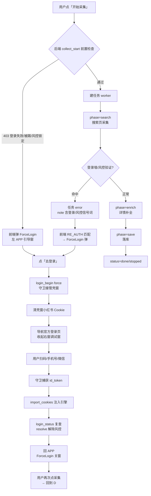

# 采集与登录闭环 操作流程 SOP

> 版本：R-6.22 系列（基于实际代码链路梳理，2026-11-02）
> 用途：把「点开始采集 → 采集执行 → 遇到登录/风控 → 引导登录 → 恢复 → 重新采集」的完整操作流程细化到每一步，作为测试、改码、验收的统一口径。
> 约定：本文是「需求文档 × 代码现状」的对齐产物；凡代码行为与用户拍板冲突处，在「五、已知差距」中列明并推进修复。

---

## 一、总览：一次采集的完整生命周期

## 二、用户操作流程（逐步细化）

### S1 点「开始采集」

| 层 | 动作 | 分支/结果 |
|---|---|---|
| 前端 | CollectPanel 提交 collect_start（keyword/limit/筛选/间隔） | — |
| 后端 | `_check_license_or_raise` | 授权闸，free 恒放行 |
| 后端 | `_require_login(account_id)` | **403**：登录失效/被踢/风控锁定 → 前端弹 ForceLogin（见 T1） |
| 后端 | `_check_collect_throttle` | **恒放行**（R-6.15 拍板：拟人频率保护/熔断/锁定全移除） |
| 后端 | 任务唯一键防重启动（dedup 60s） | **已移除**（R-6.22h 拍板：同词/换词均允许立即重启） |
| 后端 | 停止所有 running 旧任务（stop_event） | 并发任务管理，非限制 |
| 引擎 | `new_page()` 门禁 | 未登录/风控 → 不建独立采集调试窗（引擎窗最小化，任务页走引擎内新页）；登录有效 → 恢复右半屏调试窗 |
| 前端 | 任务状态条播报 phase | search → enrich → save → done |

### S2 搜索采集执行（worker）

| 阶段 | 代码 | 行为 | 异常分支 |
|---|---|---|---|
| search | `_prepare_search_page` | 打开 `search_result?keyword=…`，45s 等 `section.note-item` | 登录墙命中 → `_handle_login_wall` + 抛 `BrowserLoginRequiredError`（登录墙页面保留不关闭） |
| search | `search()` 滚动循环 | 逐批 `_drain_page` 提取、去重、进度回调；120s 上限 | 用户停止 → stopped |
| enrich | `_enrich_notes` | 详情/作者补全（fast 跳过） | 异常 → 任务 error |
| save | `_persist_notes` | 落库 notes 表 | — |
| 收尾 | worker finally | `_mark_collect_done` | — |

**登录墙判定词表**（`_detect_login_wall`）：`扫码登录 / 登录后查看 / 请先登录 / 完成验证 / 安全验证 / 验证码`；页面 URL 含 `/login` 直接判失效。

### S3 结果呈现

| 状态 | note | 前端 |
|---|---|---|
| done | 采集完成/平台仅加载 N 条 | 结果卡片按评分排序 |
| stopped | 已停止：采集到 N 条 | 停止态 |
| error | 采集失败：{异常} | 若 note 命中 RE_AUTH → 弹 ForceLogin |

## 三、登录触发链（4 个触发点 → 统一闭环）

### T1 启动 403（登录失效/被踢/风控锁定）
`_require_login` 403 → 前端 `isLoginAbnormal(note)`（RE_AUTH 词表）→ ForceLogin 弹。

### T2 采集遇登录墙（任务 error）
worker error note 含「登录后查看/扫码登录/请先登录/验证」→ 前端 RE_AUTH 匹配 → ForceLogin 弹。

### T3 运行中被踢（引擎页面登录态失效）
被踢信号词（登录超限/请重新登录/登录已过期）→ `login_status` kicked=true → ForceLogin 复查感知。

### T4 用户主动重登（设置页）
`login_begin(force=false)` → 可关闭登录页（不锁死、不拉回）。

### 统一登录闭环（T1-T3 走 force=true）

| 步骤 | 动作 | 说明 |
|---|---|---|
| 1 | ForceLogin 弹出（左 APP 覆盖层） | 打开即调 `collapse_debug_windows` 收起右窗 |
| 2 | 点「去登录」→ `goLogin` → `apiLoginBegin(true)` | `wentLogin=true` |
| 3 | 后端 `login_begin` 置 pending+force，收起调试窗 | 右窗关闭（用户约定：登录引导时右侧要么关闭要么有提示） |
| 4 | 守卫 `login_guard` 轮询到 pending | 先 `clear_domain_cookies("xiaohongshu.com")` 清壳窗 Cookie（否则登录页检测到有效会话自动跳过扫码界面） |
| 5 | 壳窗导航官方登录页 + JS 双保险 | `xiaohongshu.com/login?redirectPath=…`；隐藏关闭按钮（强制登录不可关） |
| 6 | 用户扫码/手机号/微信 | 登录页完整渲染扫码界面 |
| 7 | 守卫页内监视捕获 `id_token` Cookie | 每轮轮询 cookies |
| 8 | `POST /api/auth/import_cookies` | 过滤 xiaohongshu/xhscdn 域 → 注入引擎 → 刷新引擎页 |
| 9 | 回 APP | 守卫导航壳窗回 `127.0.0.1:8791` |
| 10 | ForceLogin 关窗 | 条件：`wentLogin && logged_in && !risk_verify`（每秒复查，异常信号不缓存） |
| 11 | `login_status` 自动 `risk.resolve` | 登录有效 → 解除该账号软风控（manual） |
| 12 | 用户再次点采集 | 走 S1 → 正常执行 |

## 四、状态与判定（权威口径）

- **登录判定四元组**：`(has_ws, page_logged_in, kicked, risk_verify)`
  - has_ws：引擎 Cookie 含 web_session
  - page_logged_in：引擎小红书页实际登录态
  - kicked 词表：登录超限 / 请重新登录 / 登录已过期
  - risk_verify 词表：登录后查看 / 风控拦截 / 需人工扫码 / 人工验证 / 验证后重试
- **缓存规则**：`_LOGIN_CACHE` TTL 15s，**仅正常状态写入**；kicked/risk_verify 异常信号实时返回（R-6.22f）
- **前端 RE_AUTH 词表**：重新登录 / 请登录 / 登录失效 / 登录态 / 被踢 / 登录超限 / 登录已过期 / 需要验证 / 验证登录 / 需人工扫码 / 扫码验证 / 验证后重试

## 五、已知差距（代码现状 vs 拍板约束）—— 待修复清单

| # | 差距 | 拍板/约定 | 现状 | 处置 |
|---|---|---|---|---|
| B1 | **24h 硬熔断残留** | R-6.15「风控熔断不需要」 | `_handle_login_wall` 非软风控词 → `risk.mark_hard` → cooldown → `_require_login` 403「请 X 小时后再试」 | **应移除**：统一走软风控（mark_manual + 登录引导），不锁账号 |
| B2 | 登录恢复后任务不自动继续 | 「不限制」拍板未含自动重试 | 任务 error 后需手动再点采集 | 保持手动（在 ForceLogin/状态条明确提示「登录成功后请重新点击开始采集」） |
| B3 | manual 403 文案体验 | 扫码前再点采集被拦 | 403「页面已打开登录入口，请扫码或完成验证，恢复后自动解除」 | 文案优化 + 明确引导，避免「乱」感 |
| B4 | 壳窗被登录页接管时 APP 界面消失 | 登录页在壳窗内呈现（用户拍板） | 导航即接管，无过渡提示 | 保留设计；ForceLogin 文案说明「正在打开登录页…」 |
| B5 | 任务 error 后右窗登录墙页短暂保留 | 登录引导才收起右窗 | 间隙期双窗都像「登录」 | 已在 ForceLogin 弹出时收起（R-6.22g）；确认无遗漏路径 |

## 六、基于 SOP 的测试计划（TS）

| # | 场景 | 操作 | 预期 | 状态 |
|---|---|---|---|---|
| TS1 | 正常采集 | 登录有效 → 点采集 | done，结果按评分排序 | — |
| TS2 | 未登录点采集 | 删 web_session → 点采集 | ForceLogin 弹 → 无右窗 → 任务回开始采集 | 历史 PASS |
| TS3 | 采集遇登录墙→扫码恢复 | 风控态点采集 → error → ForceLogin → 去登录 → 扫码 → 回 APP → 重采 | 全链 PASS | 历史 PASS（真实扫码已验证） |
| TS4 | 硬风控词（B1 修复前） | 触发非软风控词 | 当前 24h 熔断；修复后 = 等同软处理 | 待修复后验证 |
| TS5 | 同关键词立即重启 | 同 keyword 连点两次 | 均 200（R-6.22h） | PASS |
| TS6 | 运行中停止 | 采集中点「停止」 | stopped，不落错数据 | 待回归 |
| TS7 | 运行中被踢（T3） | 采集期间引擎被踢 | kicked 感知 → ForceLogin 弹 → 扫码恢复 | 待验证 |

## 七、Bug 迭代记录（R-6.22 系列）

### R-6.22h — 同关键词 dedup 残留 409（已修复 `6c9cd94`）
- 现象：点采集报「同一关键字采集任务进行中和刚结束，请稍后再试」。
- 根因：R-6.15 拍板移除限制时，同 keyword 60s 防重启动 dedup 被 commit 归类「业务去重」悄悄保留 → 409 拦截。
- 处置：移除 dedup 检查循环（dedup_key 仅留审计展示）；新任务启动优雅停旧任务并发管理保留。实测同关键词连点均 200。

### R-6.22i — 24h 硬熔断残留（已修复 `e2ec0cc`）
- 现象：登录墙触发后账号被锁 24h（`_require_login` 403「请 X 小时后再试」）。
- 根因：R-6.15「熔断不需」拍板未全量落地，`_handle_login_wall` 非软风控词仍走 `risk.mark_hard`。
- 处置：登录墙统一 `mark_manual`（任务中止但账号永不熔断），登录成功自动 resolve、随时可继续。

### R-6.22j — 登录墙触发时壳窗被误关/最小化 → 空白页、窗口消失（已修复 `04cebc3`）
- 现象（用户实测）：「点采集两次反应各异但都不行，最后一次把我引入空白页面」；观感「一直在开空白页面」。
- 根因三连：
  1. `new_page` 未登录/风控分支把 `ctx.pages[0]`（壳窗 APP 窗口）整体 `minimized`——本意收起调试窗，却最小化了承载 ForceLogin 的壳窗 → 登录引导不可见（窗口消失）。
  2. `front_port()` 每次调用 `find_free_port` 重新探测空闲端口：启动时 8791 空闲被 uvicorn 占用后，再次探测返回 8800 → keep_url 与壳窗实际 URL（8791）错位 → 登录引导收起右窗时误关壳窗。
  3. `cleanup_tabs`/`_find_shell` 仅用 URL 匹配保护壳窗，URL 一旦变化即误判被关/误关。
- 处置：
  - `new_page` blocked 分支移除最小化（壳窗保持可见承接登录引导，任务页引擎内新建）；
  - `cleanup_tabs` 以 `shell_window.shell_ref` 引用级无条件保护壳窗（URL 匹配仅补充）；
  - `_find_shell` 引用判活优先（URL 导航不影响）；
  - `front_port()` 以 launcher 写入的 `XHS_SHELL_URL`（uvicorn 真实监听）为权威，进程内端口稳定一致；
  - 移除引擎启动失败 20s 冷却（用户拍板：重登录场景多、封号从未出现，无需冷却；启动失败直接抛错由上层处置）。
- 验证：真实 UI 点采集 → 平台登录墙 → ForceLogin 正常弹出（mask=True）、壳窗全程存活（ev=[]）、调试窗正常收起、无 about:blank 残留。
- **平台「登录后查看」登录墙 = 平台风控/验证要求**（Cookie 有效但需人工验证），非代码缺陷；每次触发需扫码一次后重采。若希望降低触发频率，需另行拟人节奏/限频（与「零限制」拍板冲突，需用户拍板）。
